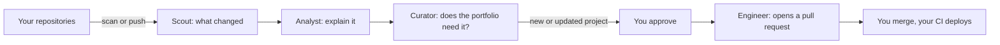

# ExoKortex

**Your portfolio, kept up to date while you work.**

ExoKortex watches the places your work lives (GitHub, Hugging Face, Kaggle, and Google Colab), explains what changed in plain words, and asks you before anything new goes on your portfolio. When you approve, it opens a pull request on your portfolio repository. You merge it. Your existing CI deploys it.

It uses your own AI key, so you choose the model and pay the provider directly. It never merges, never deploys, and never sends your keys to the model.

## How it works



1. **Connect** GitHub and any other sources.
2. **Pick** one GitHub repository as your portfolio.
3. **Scan.** The first scan is a snapshot. Later scans spot changes.
4. **Review.** Four agents read the change, explain it, and decide whether your portfolio should change. Noise is skipped.
5. **Approve** on the Approvals screen.
6. **Merge** the pull request ExoKortex opens.

New to it? Read the [user guide](docs/user-guide.md).

## Features

- Sources: GitHub repositories, Hugging Face models, datasets, and spaces, Kaggle datasets and notebooks, and Google Colab notebooks.
- Bring your own model: any OpenAI-compatible API, with presets for OpenAI, OpenRouter, and Groq.
- Human in the loop: new and updated projects wait for your approval. Nothing merges by itself.
- Pull requests only: changes reach your portfolio as a normal pull request on the branch your site deploys from.
- Scheduled scans (weekly, every 2 weeks, or monthly) plus instant scans on GitHub push.
- Email when an approval is waiting and when a pull request opens.
- Encrypted tokens and keys, with every row scoped to one user.
- A dashboard with light and dark themes, a setup checklist, and a mobile layout.

## Tech stack

One Cloudflare Worker serves the API and the dashboard.

| Part      | Choice                                    |
| --------- | ----------------------------------------- |
| API       | Hono on Cloudflare Workers                |
| Data      | Cloudflare D1, hand-written SQL           |
| Jobs      | Cloudflare Queues and an hourly cron      |
| Dashboard | React, Vite, React Router, Motion, Lucide |
| Sign-in   | Email in development, Clerk in production |
| Language  | TypeScript in a pnpm workspace            |

More in [tech stack](docs/architecture/tech-stack.md) and the [architecture overview](docs/architecture/overview.md).

## Run it locally

You need Node.js 22.18 or newer and pnpm 12.

```powershell
pnpm install
pnpm setup
pnpm db:migrate:local
pnpm dev
```

Open http://localhost:5173 and sign in with any email. Connecting GitHub, Google, and email needs your own app credentials. See [local development](docs/development/local-development.md).

Checks:

```powershell
pnpm test
pnpm typecheck
pnpm lint
pnpm build
```

`pnpm build` does not deploy anything.

## Project layout

```text
apps/
  web/        React dashboard
  worker/     Cloudflare Worker: API, queue consumer, cron
packages/
  agents/            Agent prompts and output schemas
  core/              Workflow states, limits, change detection
  database/          D1 repositories and migrations
  github/            GitHub App client
  huggingface/       Hugging Face client
  kaggle/            Kaggle client
  google/            Google Drive client for Colab notebooks
  source-providers/  Common interface for the source clients
  jobs/              Retry, backoff, and idempotency
  llm/               OpenAI-compatible client
  orchestrator/      Runs the scan and engineer jobs
  security/          Encryption and signatures
  shared/            Shared types and log redaction
docs/                Product, architecture, integrations, decisions
```

## Status

All planned slices are done and the app runs locally. It has not been published yet. What is left before release is in [release readiness](docs/product/release-readiness.md). Bigger ideas are in [feature ideas](docs/product/feature-ideas.md).

## Documentation

- [User guide](docs/user-guide.md)
- [Product vision](docs/product/vision.md)
- [Release readiness](docs/product/release-readiness.md)
- [Feature ideas](docs/product/feature-ideas.md)
- [Slice tracker](docs/product/roadmap.md)
- [Local development](docs/development/local-development.md)
- [Deployment](docs/development/deployment.md)
- [Security](docs/architecture/security.md)
- Integrations: [GitHub](docs/integrations/github.md), [Hugging Face](docs/integrations/huggingface.md), [Kaggle](docs/integrations/kaggle.md), [Google](docs/integrations/google.md)
- [Decisions](docs/decisions/README.md)

## Contributing

See [CONTRIBUTING.md](CONTRIBUTING.md). Report security problems as described in [SECURITY.md](SECURITY.md).

## License

[MIT](LICENSE)
